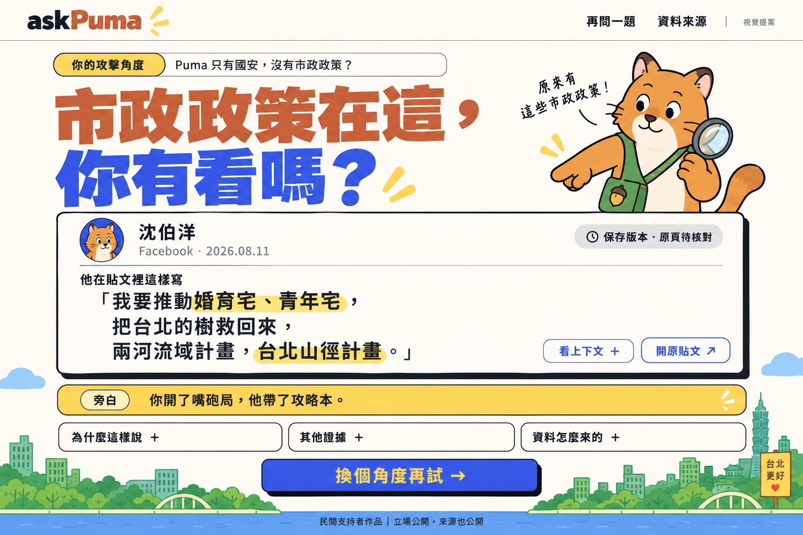
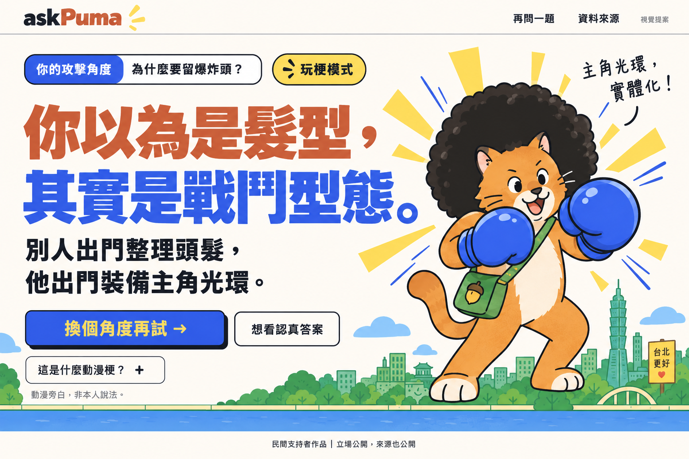

# 回答頁視覺提案 v2

2026-10-04，Asia/Taipei。依使用者要求，用 built-in image_gen 補第二、三張關鍵畫面；都以已認可的 [01 首頁](01-home-desktop.png) 為風格參考。兩張是同一網站的不同回答狀態，不要求增加兩個獨立路由。圖片皆為 1536×1024；本輪沒有實作網站。

## 02：原貼文回答

一句大字結論 → 一張本人原文卡 → 一句旁白。原文短句、日期、平台、原連結在同一張卡；「上下文」、「為什麼這樣說」、「其他證據」、「資料怎麼來的」都用可展開控制，預設不鋪長篇。

用「只有國安，沒有市政政策？」這個示意輸入測試通用布局，沒有延用針具／WHO 的固定三欄。發布時所有句子、卡片數量與來源類型依實際結果，不把圖中文字 hardcode 到每個議題。

示例摘錄來自 [ATTACK_RESEARCH 的 P03](../../docs/ATTACK_RESEARCH.md)，保存版發文日期為 2026-08-11；圖中明示「保存版本・原頁待核對」，沒有假認證、按讚數或留言。作者頭像是示意角色圖標，不是沈伯洋真實帳號頭像。另已讀 [本人官網 HEART 政策頁](https://puma.taipei/heart)，有住房、交通等政策主張；有主張不等於已證明政策成效。

## 03：動漫玩梗回答

題目「為什麼要留爆炸頭？」搭配超大答案「你以為是髮型，其實是戰鬥型態。」原創 Puma 貓戴爆炸頭、藍色拳套，保留首頁綠背心與台北市景。這是動漫聯想與本站旁白，圖中直接標示「玩梗模式」和「動漫旁白，非本人說法」。

這種題目不強制塞入不存在的政治證據卡；「這是什麼動漫梗？」按開才解釋，另有「想看認真答案」入口。原創插畫沒有使用官方動漫角色、截圖或標誌。

## 前端夥伴的落地重點

- 首頁沿用 01，回答視覺以此 v2 優先；[舊版 02／03](README.md) 留作歷史探索。
- 標題、引用、按钮與折疊必須做成真實 DOM；整頁 PNG 不能拿來替代可操作網站。
- 政治題保留原文與查核狀態，玩梗題保留旁白身份。沒有本人貼文時按真实來源改為影片／官方紀錄卡，不冒充社群貼文。
- 手機改單欄；縮小裝飾貓與市景，維持結論和原句先出現。此次 03 是桌面玩梗狀態，不是新版手機圖。
- 生成圖不是逐像素規格。實作時正文和狀態至少可讀，主動作可點、展開有鍵盤操作，邊距和字級按手機調整。
- 選詞與資訊取捨依 [RESULT_DESIGN](../../docs/RESULT_DESIGN.md)、[HUMOR_MODE](../../docs/HUMOR_MODE.md)，來源／結果依 CONTRACTS。新增互動模式欄位仍由 A 統一。

## 檔案與驗證

使用 built-in image_gen，沒有使用 CLI fallback 或專案 API key。完整實際提示詞已存 [PROMPTS-v2.md](PROMPTS-v2.md)。兩張生成後已視覺檢查：配色、字標、主要文案、短引文、折疊入口與保存版／玩梗標籤符合本輪方向；後續真實引用仍由 D 查核，生成圖不升級資料狀態。舊圖未覆寫。
