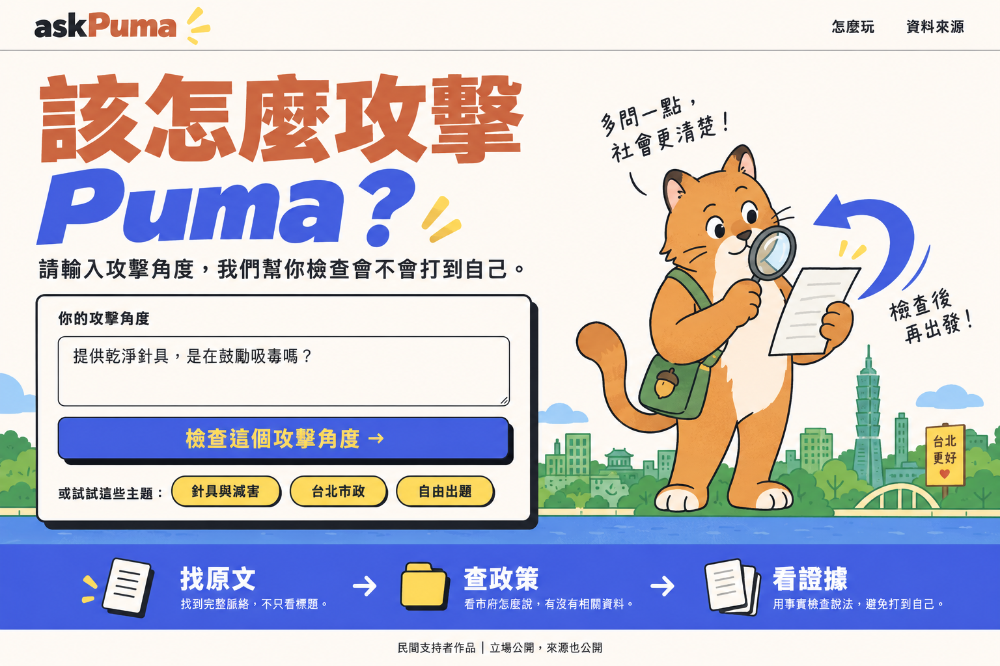
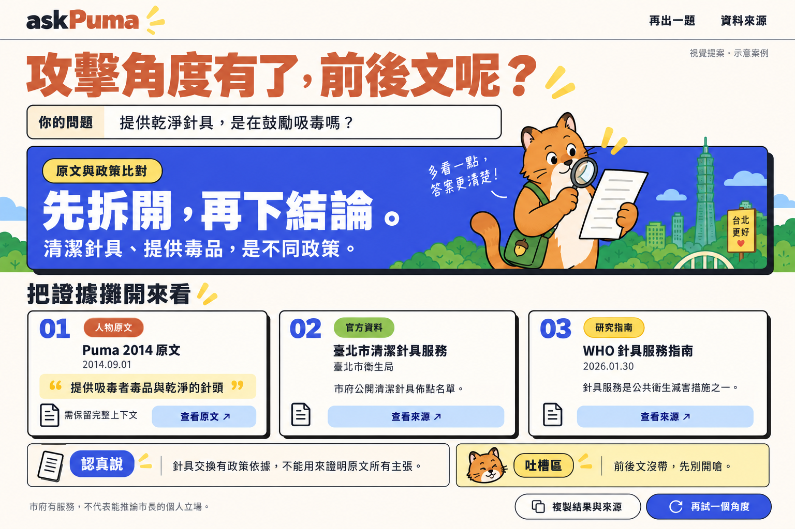
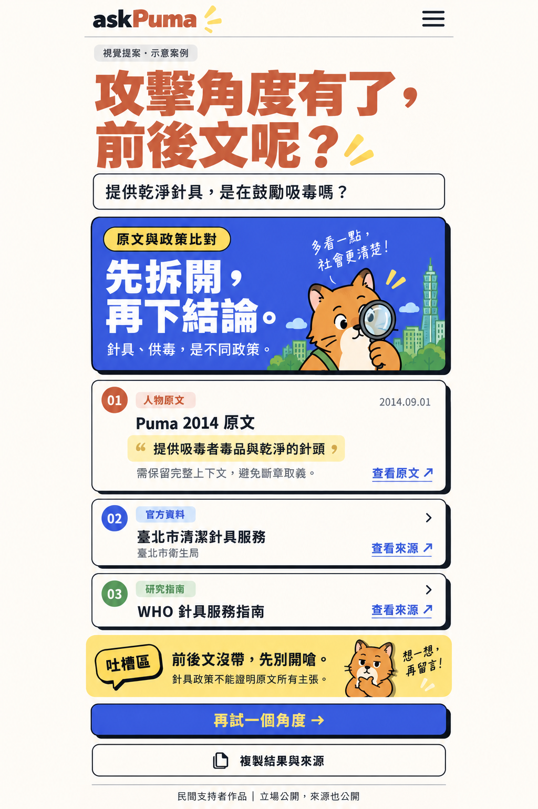

# askPuma 視覺提案 v1

> **2026-10-04 最新：[新版 02／03 已生成，請先看 v2](README-v2.md)。** 01 首頁已認可；本頁舊 02／03 只保留作歷史探索。回答頁改用通用的「大字結論＋本人原貼文」，詳細分析與其他佐證按開才看；不照針具案例的三欄卡片布局實作。新增動漫玩梗題，與事實查核共用風格、分開呈現。最新規格見 [RESULT_DESIGN](../../docs/RESULT_DESIGN.md)，素材見 [攻防研究](../../docs/ATTACK_RESEARCH.md) 與 [搞笑模式](../../docs/HUMOR_MODE.md)。

2026-10-04，Asia/Taipei。使用者要求先用 imagegen 提出關鍵畫面；本輪只製作設計圖，沒有實作網站。三張 PNG 用 built-in image_gen 生成並逐張檢視，原始檔已保留；完整提示詞見 [PROMPTS.md](PROMPTS.md)。

## 視覺參考與提案方向

實際透過瀏覽器檢視 [Puma「市長，你給我聽好了」頁面](https://puma.taipei/taipeispeaksup)：白色導覽、暖白內容區、陶土橘粗中文標題、鮮藍舞台、綠色台北天際線、動物市民插畫，以及帶黑色偏移陰影的發言按鈕。

延續這些視覺語言，為 askPuma 建立自己的字標與原創「拿放大鏡的 Puma 貓」。藍色回旋箭頭呼應「檢查會不會打到自己」，文件與放大鏡呼應查原文。作品的民間支持者定位放在頁尾，沒有使用官方字標、捐款或 LINE 導流。

下面 HEX 是**提案用配色**，不是已量測的官方色票。

| 色彩 | 提案色值 | 用途 |
|---|---|---|
| 暖白 | `#FFF9F3` | 底色、證據卡 |
| 陶土橘 | `#CE7950` | 中文大標、人物原文類型 |
| 鮮藍 | `#4B5CDA` | 主按鈕、結論區、Puma 字樣 |
| 炭黑 | `#272822` | 正文、細描邊、偏移陰影 |
| 葉綠 | `#97B565` | 市景、官方資料類型 |
| 奶油黃 | `#F9D76C` | 重點畫線、研究指南類型、吐槽區 |

中文標題粗重、有張力；正文保持易讀。大面積平色搭配少量手繪線條，讓諷刺感出現在標題與吐槽，證據區保留清楚的資訊層級。

## 01：桌面出題首頁

首頁只聚焦一件事：輸入攻擊角度。大標「該怎麼攻擊 Puma？」、副標、輸入框和藍色主按鈕形成視線順序。右側原創 Puma 貓看文件，背景用台北市景建立地方感。下方「找原文 → 查政策 → 看證據」讓人一眼理解流程。

這張圖的問題文字是示例輸入；主題 chip 要以實際支援範圍為準。已有針具案例時可用該題，不暗示所有市政主題都已有完整資料。

## 02：桌面證據與結論

**此張已被使用者要求改方向，以下是舊提案說明，不作現行布局規格。**

上方保留使用者問題，中間藍色結論區用一句「先拆開，再下結論。」示意本案例的分析。下面三張卡按來源責任分組：人物原文、官方資料、研究指南。原句用短摘錄與黃色標記，日期、來源和原文連結保留。

下方「認真說」與「吐槽區」分開：分析有證據與限制，吐槽是旁白。此例刻意保留 2014 原文的供毒措辭，針具政策不能用來證明原文所有主張，也不能直接推論市長的個人立場。例子的短引文與來源來自 [研究備忘](../../docs/SOURCES.md)，正式資料仍須按契約逐筆核對。

實際 title、verdict、summary、roast 依 API 結果渲染，不固定套用這張圖的結論。證據不足、有效質疑和錯誤狀態沿用相同視覺層級，文案依契約改變。

## 03：手機證據與結論

**此張已被使用者要求改方向，以下是舊提案說明，不作現行布局規格。**

手機用單欄，第一張原文卡展開，其他卡提供摘要與明確連結。插畫縮小放入結果區；複製與再出題按鈕各自占整行，方便點擊。

生成圖用於視覺方向，**不當成逐像素尺寸規格**。落地時手機側邊留白約 16–20px、正文至少 16px、點擊區至少 44px；調低標題與結果區的高度，讓第一張證據更早出現在視窗。桌面採三欄來源卡，窄螢幕改單欄。

手機圖的來源 badge 配色與桌面略有差異，實作時統一為：人物原文＝橘、官方資料＝綠、研究指南＝黃；搜尋摘要與未核對匯入另用中性標籤，按 CONTRACTS 的 reviewStatus 標示。

## B 的落地順序

布局以 RESULT_DESIGN 為準；本節舊三欄與單案例描述不優先於新規格。

1. 標題、表單、導航、結論和來源卡做成可操作 DOM；圖片中的文字不是資料或應用程式。
2. 先完成暖白＋橘藍配色、排版、2px 左右描邊、4–6px 黑色偏移陰影，以及桌面／手機布局。
3. 使用 A 的型別與 API 契約，把來源原句、日期、連結、未核對狀態和模型分析接好。
4. Puma 貓與市景是裝飾插畫的方向；第一版可以簡化，待必要功能通過後再製作獨立插畫資產。三張整頁 mockup 只作設計參考。
5. 卡片展開與一次結論登場已足夠展示互動；細緻動畫排在部署和資料正確性之後。

本輪沒有新增套件、字型下載、網站程式或雲端部署。資料／功能／費用限制仍以 [PLAN](../../docs/PLAN.md)、[CONTRACTS](../../docs/CONTRACTS.md)、[ENVIRONMENT](../../docs/ENVIRONMENT.md) 為準。
