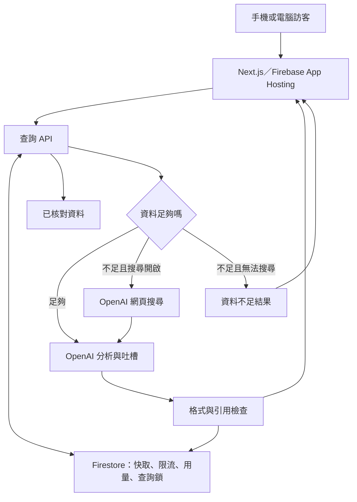

# 服務架構與運作

**目前已實作並公開上線。** 下面保留工程規劃；實际完成範圍、檔案、正式站與預算日期控制以 [DELIVERY.md](DELIVERY.md) 為準。

**2026-10-04 最新施工基準：** 先讀 [IMPLEMENTATION_PLAN.md](IMPLEMENTATION_PLAN.md)、[DEMO_CASES.md](DEMO_CASES.md)、[CONTRACTS.md v2](CONTRACTS.md)。Demo 固定針具 → 爆炸頭 → 午餐；網站由我們／Codex 做，真人夥伴補題與查核。早期選題與已過時間表以新方案覆蓋。本文仍是待實作設計。

本文描述目標架構，尚未實作或測試。欄位以 CONTRACTS.md 為準，優先級以 PLAN.md 為準。

2026-10-04 更新：Firebase／App Hosting backend／Firestore／IAM 已建立；已部署後端專用 Firestore 規則，尚無應用 build／rollout。實際資源與下一步以 [ENVIRONMENT.md](ENVIRONMENT.md) 為準，本文其餘 API、快取、限流與預算仍是待實作設計。

## 系統配置

| 部分 | 選擇 |
|---|---|
| 網站 | Next.js＋TypeScript，選 Firebase 當下支援且已修補的版本；保留 lockfile |
| 部署 | Firebase App Hosting，先用預設 HTTPS 公開網址 |
| API | 同一 Next.js 應用的 Node.js Route Handlers |
| 模型 | OpenAI Responses API，預設 gpt-6-astra，先採 low reasoning，實測後調整 |
| 核對資料 | 隨部署版本打包的小型來源資料；不需要向量資料庫 |
| 貼文索引 | 公開觀測站 JSON 正規化後只在後端檢索；未核對紀錄與核心證據分開 |
| 共用狀態 | Firestore：快取、結果、查詢鎖、限流與用量 |
| 密鑰 | Cloud Secret Manager；只在 runtime 供後端使用 |
| 認證 | 訪客免登入；後端透過服務帳號／IAM 存取 Firestore |
| 監控 | Cloud Logging：request ID、模式、耗時、錯誤、token 用量、來源 ID |

不另拆 Cloud Functions、Redis、排程或爬蟲服務。前端不直接寫 Firestore。

## 查詢生命週期

1. 驗證輸入、長度、匿名 session 與請求識別。
2. 做全站／訪客的廉價流量檢查，先精確匹配已驗收公開案例，再查共享快取。已整理／已儲存標示按 CONTRACTS v2，不設隱藏 demo 路徑。
3. 快取鍵由完整問題與資料／提示／模型版本組成。只做空白等保守正規化，不刪否定詞，不用主題名代替整句問題。
4. 沒有有效快取時，用 Firestore transaction 取得查詢鎖、確認限流和總額度、預留費用。
5. **交易完成後**才呼叫 OpenAI；交易 callback 可能重跑，不能把付費外部呼叫放進去。
6. 本地資料小量檢索，以問題相關性取段落，不把無關資料硬套到新議題。
7. 本地資料足夠：一次模型呼叫產生結構化分析與吐槽。
8. 不足：最多一輪有時限的搜尋，再做結構化整理；採兩階段可先取得可核對的來源表。正常路徑最多兩次模型請求，另限制工具呼叫次數；重試不能無限增加呼叫。
9. 檢查格式、來源 ID 與 URL。格式正確不代表語意正確；QA 必須核對證據是否真的支持結論。
10. 存結果、更新快取與實際／預留用量、釋放鎖，回傳前端。

本地路徑希望在約8–20秒內完成，這是待測目標；新議題允許較長等待。先設單筆總處理上限約60秒，前端和主機設定須相容。不要為了達成延遲數字假裝完成。

## 證據與搜尋

- 原話卡直接讀收錄文字，不由模型重新生成。
- 本地來源 ID 是穩定識別；AI 引用 ID，後端對應到原始網址。
- 新搜尋來源從工具回傳的引用／consulted sources 建立來源表，不能信任模型自行生成的 URL。
- 搜尋優先人物原文、政府與研究；必要新聞轉述明確標記，不能假裝是第一手訪問影片。
- 搜尋摘要未逐段核對前，顯示為搜尋摘要，不渲染成精確原話。
- 搜尋失敗、資料不足或來源衝突，保留不確定性，不補寫不存在的文獻。
- 動態搜尋結果不自動升級成已核對的共用來源；先由 D／A 檢查。
- 不在90分鐘內製作全量 Facebook 爬蟲，也不保證歷史資料完整。

現成索引的匯入、輕量檢索與降級規則見 [DATA_ACQUISITION.md](DATA_ACQUISITION.md)。不把全量貼文送入每次模型 context，也不把 upstream AI 分類當查核結果；imported_unchecked 顯示來源限制，重要主張補原文或其他證據。

## Firestore 儲存設計

以下是待實作的集合規劃，不是已建立的資源：

| 集合／文件 | 內容與用途 |
|---|---|
| auditCache/{hash} | 結果 ID、版本、有效期限；相同問題共用 |
| auditResults/{id} | 分析、來源、時間、版本、用量 metadata；ID 用隨機不可猜測值 |
| auditLocks/{hash} | 執行中的請求與 lease 到期時間，避免重複計費 |
| rateLimits/{key} | 匿名 session／IP／全站時間窗計數 |
| usageDays/{taipeiDate} | 已用成本、預留成本、請求數；日期以 Asia/Taipei 計 |
| config/service | 新分析開關、搜尋開關、當日服務預算 |

快取預設最多24小時，資料／提示版本變動即失效。程式必須自行檢查期限，不依賴 TTL 刪除立即發生。分享快照若實作，保留產生時間與版本，不默默用新結論覆蓋舊分享內容。

不提供可列出所有訪客問題的公共 endpoint。分享功能只在使用者按下分享後建立可公開讀取的快照；最小版本只有複製文字。

Firestore 的控制文件失效或無法讀寫時，回傳暫停新分析。不要為了可用性繞過費用控制。

## 公開用量控制

初始建議，A／C 可依實測調整並記錄：

- 每個匿名 session 每10分鐘3次新分析；匿名識別不是可靠身分，仍需 IP 與全站控制。
- IP 採較寬鬆的第二層限制，考慮現場共用 Wi-Fi；不直接把 IP 當成單一人。
- 全站同時新分析先限制約4–6筆，用共享狀態控制；滿載回覆可重試，不建立複雜任務佇列。
- 重複問題受查詢鎖保護。快取結果仍受合理讀取速率限制，但不算新的付費分析。
- 限制輸入、context、總輸出 token（包含 reasoning）、搜尋工具調用與重試數。
- 應用層新請求門檻建議設在 US$45，留US$5緩衝；已用＋預留不足以接新請求就停止。
- 預留額度用已設定的模型／token／工具上限做保守估算。完成後按回傳 usage 校正；失敗但無法確認計費時，不把未知費用一律退回。
- OpenAI 專用 project 月度 hard limit 設US$50，搭配提醒。這會影響後續日期使用，首日之後需另作預算決策。官方說執行有傳播延遲，可能略超額；不宣稱绝對零超支。
- provider budget error 不盲目重試；依賴故障顯示友善錯誤。

若預留成本估算無法在期限內可靠完成，保留 provider hard limit、全站付費請求數上限、token／搜尋上限及總開關；不宣稱應用已能精確保證美元上限。把實際退路記入交付。

## 部署與密鑰

A 在開始後確認：Firebase project ID、Blaze、App Hosting backend、Firestore、部署來源與後端服務帳號權限。

- 模型金鑰放 Secret Manager，授予本 App Hosting backend 讀取權，僅 runtime 使用。
- Firestore 後端使用 Application Default Credentials 和必要 IAM 權限；不把服務帳號 JSON 放前端或 Git。
- 本機需要憑證時用既有受控登入或本機憑證，請勿在日誌中列印內容。
- 選現有可用且合適的地區；App Hosting 與 Firestore 地區皆以專案實際支援為準。
- 初始 minInstances=0，maxInstances 小量（例如2）；實測再調。最大實例數不是費用絕對上限。
- 第一次部署只需首頁可開；AI 未配置時清楚顯示尚未啟用，不回傳假分析。
- 14:10 提交最後候選並部署；確認 rollout 成功、正式網址無痕可開、真的能分析，再提交。
- API US$50 不包括 Firebase／Firestore／主機；設定平台提醒與可用控制，記錄費用設定。

## 官方文件（2026-10-03 查閱）

- [Firebase App Hosting 框架支援](https://firebase.google.com/docs/app-hosting/frameworks-tooling)
- [App Hosting 設定與 Secret Manager](https://firebase.google.com/docs/app-hosting/configure)
- [App Hosting 費用與 Blaze](https://firebase.google.com/docs/app-hosting/costs)
- [Firestore transaction](https://firebase.google.com/docs/firestore/manage-data/transactions)
- [Firestore 後端與 ADC](https://firebase.google.com/docs/firestore/quickstart-server)
- [OpenAI gpt-6-astra](https://developers.openai.com/api/docs/models/gpt-6-astra)
- [OpenAI 網頁搜尋](https://developers.openai.com/api/docs/guides/tools-web-search)
- [OpenAI hard spend limit](https://developers.openai.com/api/docs/guides/spend-limits)

帳號權限與實際配額仍需開工確認；開始實作時核對上述文件，不沿用過期的 SDK 參數。
