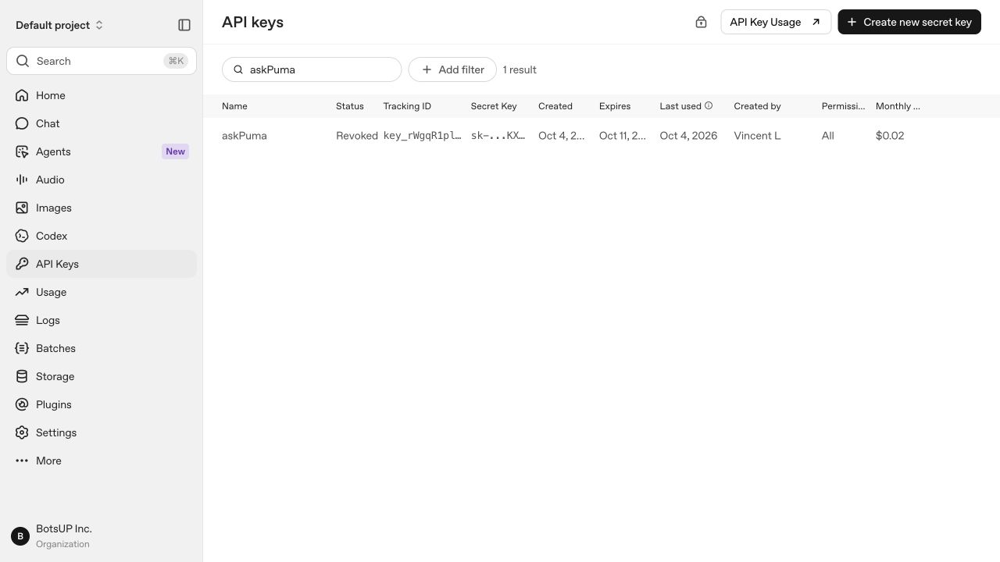

# askPuma 下線與本機清理紀錄

2026-10-05（Asia/Taipei），使用者確認下線，之後要求只保留 GitHub 專案並移除本機 repo。

## 雲端下線：已驗證

- `askpuma-prod` 已解除 Cloud Billing 連結；`billingEnabled=false`。
- Google Cloud／Firebase 專案已刪除申請，`lifecycleState=DELETE_REQUESTED`。App Hosting／Cloud Run、Firestore、映像檔、部署儲存桶與 Secret Manager 隨專案進入刪除程序，不表示各資源已完成實體清除。
- 網站首頁與 `/api/health` 均回傳 HTTP 404。
- BotsUP 共用帳單保持啟用，其他專案未受操作。
- askPuma 專用 OpenAI 金鑰已撤銷，平台狀態為 Revoked；Downloads 金鑰檔及本機 `.env.local` 裡的金鑰已移除。
- 當時 OpenAI 金鑰管理頁顯示月用量 US$0.02，並非最終帳單保證。

驗證摘要：[JSON](evidence/decommission-2026-10-05.json)。

## 本機資料清理

- 三個開發 worktree 先封存未提交內容，再移除。
- 封存包裡的 afro／detective／taipei 三張插圖與主 repo 已保存版本逐位元相同。唯一 tracked patch 為 Next.js 自動產生的 `next-env.d.ts`；其餘為 `tsconfig.tsbuildinfo` 及 node_modules symlink 記錄，均可重建。封存包不需要永久保存。
- 可刪產生檔：`.next` 約 146 MB、`node_modules` 約 462 MB，及本機快取、封存包。
- 主 repo 刪除前總占用約 640 MB。
- 下線文件與無金鑰的驗證資料保存於 GitHub main；三個開發分支 `codex/backend`、`codex/data`、`codex/ui` 亦保存於 GitHub，保留原始提交歷史。
- 流程：先推送並逐一核對 GitHub commit SHA，再刪除本機 `/Users/vincentno1/Documents/GitHub/askPuma`。
- 不刪除 Downloads 的 Demo 影片，不修改相鄰的 botsup-v0 或其他專案。

## 日後重現

Git clone 後執行 `npm ci` 可重建依賴，`npm run build` 可重建產物。若要恢復網站或模型呼叫，需另外建立自己的 Firebase／OpenAI 環境及設定；原雲端環境與專用金鑰已停用。

## 帳單與復原

先前累積的 Google Cloud 費用可能延遲顯示，需依 `askpuma-prod` 篩選核對；未建立自動追蹤。Google 專案一般有 30 天復原期，但部分資源可能提早清除，不保證完整資料可復原。

- [Google Cloud 停用計費](https://docs.cloud.google.com/billing/docs/how-to/modify-project#disable_billing_for_a_project)
- [Google Cloud 刪除與復原](https://docs.cloud.google.com/resource-manager/docs/delete-restore-projects)
