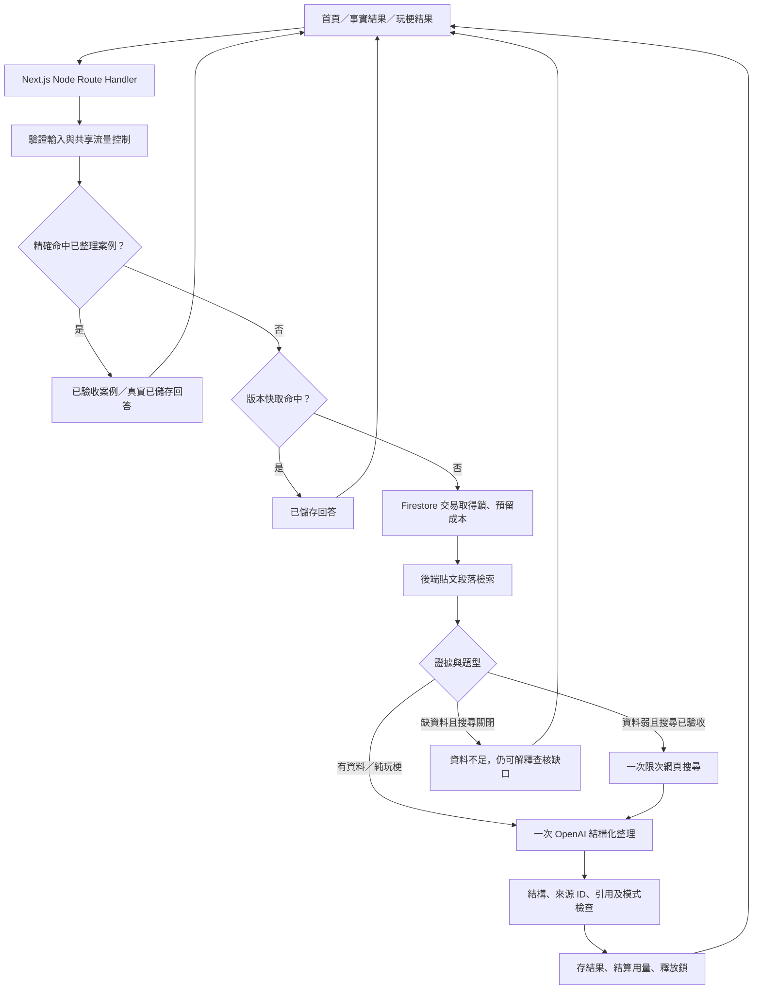

# askPuma 工程實作方案 v2

2026-10-04，Asia/Taipei。這是最新施工方案，不是已完成功能清單。使用者本輪要求規劃；本輪不建立應用、不呼叫付費 API。開工與雲端操作依 AGENTS.md。本文、DEMO_CASES.md、CONTRACTS.md v2 覆蓋舊文件中不一致的選題、分工與時程。

## 交付目標與施工順序

公開網站「該怎麼攻擊 Puma？」：首頁忠於 01、事實回答忠於 02-v2、搞笑回答忠於 03-v2。首屏只有大字結論、一張必要原文卡、一句旁白；上下文與分析按開。網站由我們／Codex 實作，兩位真人夥伴補題目、來源及 QA，不要求他們負責前端。

| 順序 | 必須交付 | 完成的定義 |
|---|---|---|
| 1 | 可部署的共用骨架與契約 | build 通過，首頁與健康路由可開；未啟用 AI 時如實顯示 |
| 2 | 三個漂亮且可靠的 Demo 案例 | 針具 → 爆炸頭 → 午餐；正文、来源、模式、限制均驗收 |
| 3 | 真實自由輸入 | 至少一個不在題庫的問題完成實際 API 分析；未知或有理的質疑不硬反駁 |
| 4 | 公開上線控制 | 後端密鑰、共享限流／預算／鎖／快取、友善錯誤，正式網址驗收 |
| 5 | 有餘裕加分 | 限次網頁搜尋、複製附來源文字、少量動效 |

第 5 項搜尋是產品目標；若來不及驗收，保留索引檢索＋真實生成，缺資料就說不足。先刪分享頁、向量資料庫、登入、後台、排程、全歷史爬蟲、自訂網域，不砍視覺、引用或自由輸入。

## 架構：兩條回答路徑，共用一套產品

三個案例對所有訪客開放，不設隱藏 demo 開關、不假裝即時生成。畫面標「已整理案例」或「已儲存回答」。正式案例最好先由真實 API 整理，再經人核對、精修短句、保存來源與版本。編輯後 answerOrigin=curated；純重播已生成結果為 saved。它們是網站正常功能，不是 fake fixture。

自由輸入同樣 POST /api/audit；沒有命中才檢索與生成。不同問題不能只因都含「午餐」就套同一答案。P0 案例只匹配 canonicalQuery 與逐一審核的完整別名，保留否定詞、日期與條件；其餘走自由路徑。沒有強制讓 Puma 正確的 prompt。

## 技術選擇與檔案邊界

- Next.js／TypeScript、App Router、Node.js Route Handlers；不使用 Edge 執行 Firebase Admin。
- Firebase App Hosting 沿用 askpuma-prod／backend askpuma／asia-east1，Firestore 沿用既有 Taiwan default database；不另建資源。
- Node 22，框架選 Firebase 支援且已修補的版本並保留 lockfile。開工時核對支援與安全公告，不用未修補的 15.2.0；官方現列 15.2.x 為 active，較新分支可能仍為 preview。
- 最小依賴：openai、zod、firebase-admin，加 Next.js 本身；動畫先 CSS，圖示用少量自有 SVG，無須大型 UI／動畫庫。
- OpenAI Responses API，保留 gpt-6-astra、reasoning low 的既定選擇；實際 key 的模型權限要先做一次小量呼叫確認。存取失敗不默默換模型。

| 預定路徑 | 擁有者 | 內容 |
|---|---|---|
| src/contracts/audit.ts | A | CONTRACTS v2 的 Zod 與 TS 型別 |
| src/app/layout.tsx、框架／依賴／部署設定 | A | 基準骨架與正式整合 |
| src/app/page.tsx、globals.css | B | 同頁輸入／結果、樣式 token |
| src/components/ | B | Header、AttackForm、QueryChip、FactResult、PlayfulResult、SourceCard、DetailsPanel、Mascot、ServiceNotice |
| public/illustrations/ | B | 經核可的獨立插畫，不能把整頁提案當 UI |
| src/app/api/audit/route.ts、health/route.ts | C | HTTP 與錯誤契約 |
| src/server/ | C | retrieval、case matching、OpenAI、validation、Firestore controls、cache、usage |
| scripts/import-posts.ts、data/ | D／A 指定一人 | 匯入、正規化與核心來源／案例；不互改同一檔 |
| docs/case-intake/ | 真人夥伴 | 可讀文字題卡；經 D／A 核對後轉正式案例 |

以上是待建立路徑。A 先提交共同基準，再讓 B／C／D 用獨立 worktree 交小批 commit；共用契約、lockfile 與部署只有 A 改。角色是施工分工，本輪沒有自動啟動代理或新任務。

## 把 mockup 變成真實網站

### 畫面與比例

首頁：上方 askPuma 字標，左側巨大橘色中文＋藍色 Puma?，右側偵探貓，下方輸入卡與藍底黃色字按鈕；底部台北城市／河流與三步驟區。三個範例改為「針具與減害」「爆炸頭」「營養午餐」，各自送出完整問題。

事實結果：頂部保留使用者問題；兩行大字結論；一張橫向原文卡（人物／平台／日期／核對狀態／短摘錄／上下文／原頁）；黄色旁白；三個折疊區「為什麼這樣說」「其他證據」「資料怎麼來的」；再問一題。針具與午餐共用這個布局，不另做 WHO 三欄頁。

玩梗結果：問題＋「玩梗模式」；两行大字；一句動漫旁白；爆炸頭拳套貓；重試／認真答案／梗的說明。不強塞假人物原文卡，固定可見「動漫旁白，非本人說法」。認真答案按鈕改送「有公開資料說明沈伯洋留爆炸頭的原因嗎？」；不能顯示同一句笑話冒充事實。

桌面內容最大寬約 1280–1400px；首屏主要內容避免被 city 裝飾擋住。手機 <768px 單欄：標題→必要原文→旁白→折疊／按鈕；偵探貓縮成側邊或卡旁小圖，玩梗貓可較大但不把回答擠到下方。文字不能烘焙在圖片。

### 樣式基準（起始值，按實際截圖微調）

| token | 建議 |
|---|---|
| 暖白背景 | #FFF9F3 |
| 陶土橘 | #CE7950 |
| 主要藍 | #4B5CDA |
| 墨黑 | #272822 |
| 黃色重點 | #F9D76C |
| 市景綠 | #97B565 |
| 卡片／按鈕 | 2–3px 黑框，5–8px 偏移黑影，16–24px 圓角 |
| 主標 | 中文粗黑 900；桌面 clamp 約 64–112px，手機 38–56px |
| 原話 | 桌面 28–36px，手機 20–26px，1.4–1.5 行距 |
| 小字 | 來源與標籤至少 14–16px，不以低對比隱藏限制 |

藍／橘可裝飾，正文與必要小字用墨黑；按鈕焦點清楚，觸控目標至少 44px。字型優先可本地打包的繁體中文字型／系統粗體，字重與載入需實測；不要因外部字型阻塞首屏。短引文的 mark 必須來自已存段落範圍，保留原字、否定與條件。

### 插畫與動效

提案 PNG 只當風格參考。需要獨立透明偵探貓、爆炸頭拳套貓（首頁可重用偵探貓），城市背景可另生成或以自有幾何 SVG 做。後續生成／改圖用 imagegen，沿用提案參考；不要用 Python 去背或裁圖，亦不截取文字拼回網站。先產出兩個角色就可做三個狀態；圖片必須作資產保存、壓縮與標尺寸，不能在瀏覽器逐次生成。

按壓 120–160ms、卡片顯示 220–300ms、標題→卡→旁白間隔 60–80ms，整體約 400–500ms；transform＋opacity，非長載入動畫。respect prefers-reduced-motion，不能靠動畫延遲已完成回答。P0 完整靜態 UI 先交，基本 reveal 與按鈕影子縮短再補。

### 必要状态

idle／loading／factual／playful／mixed／insufficient／error。載入只顯示「正在核對資料」，沒有 SSE 就不演出虛構的逐步爬取。送出時防重點擊；保留問題；再問時聚焦輸入。限制或未核對狀態須直接可見；其他小字按開。動態網頁搜尋引用也要能直接點到支持該結論的來源，不能把所有 citation 隱藏到折疊後。

## 資料：直接利用現成索引

使用者提供 https://mayor2026.observe.tw/taipei/shen-poyang/ 。本輪唯讀核對：732 筆跨平台紀錄，Facebook 兩個帳號合計 223 筆；不是全部歷年 Facebook。全量 endpoint：

https://mayor2026.observe.tw/api/posts/shen-poyang.json

JSON 根物件含 candidate、count、posts、version；posts 內目前有 id、platform、postedAt、sourceId、text、url、keywords 等。開工時取一份快照，保留上游 version、retrievedAt、hash；不在每個訪客請求重新抓全量，也不把全量送給模型。

1. 匯入驗證 JSON，去重 id／URL／正文 hash，日期以 postedAt 保留時區；UTC 轉台灣顯示，不自行補猜日期。
2. 只收作者／來源帳號已列入白名單的貼文，正文當文字；upstream AI topics／classification 只助檢索，不當真假判定。
3. 正文按自然段約 300–700 中文字切段，保留前後文與 excerpt ID。先用中文字 bi-gram／關鍵字分數＋可審核同義詞詞典；不以英文空白切詞。
4. 查詢只送最相關約 5–8 段，整包 context 上限待 token 實測（起始目標 8k input tokens 以下）；高分仍不等於已證實。
5. 核心來源另建 reviewed 集合；全部匯入預設 imported_unchecked，原頁逐筆核對才可 checked。資料庫保存版可以顯示，但要寫「保存版本・原頁待核對」。
6. 針具補政府／WHO 原始來源；午餐補官方完整回應／早晚原話；2014 原文不在新索引覆蓋內。開工先完成三題，不抓蔣萬安全量；需要對照才補那幾筆。

本輪找到的新針具候選：2026-10-03 16:01:23 台灣時間 Threads，https://www.threads.com/t/DeBlQ6YlHK1 。工具本輪無法開啟原頁，保存文字可作候選，不可標原頁已核對。詳見 DEMO_CASES。

## AI：濃縮內容，不創造證據

OpenAI 的工作是把問題拆成可查主張、選本次資料中相關的 excerpt ID、寫一句短結論／一句旁白／折疊說明。原話、作者、日期、網址與來源狀態全部由伺服器填入，模型不可自行杜撰。

正常路徑最多兩次請求：本地足夠或純玩梗一次 structured output；陌生事實题先一次 web_search 收集來源，再一次 structured output。不要另加分類、潤稿、critic 三個模型呼叫。P0 規則先判明確玩梗与題庫；模糊或含實質指控的輸入保守走事實路徑，模型最後可回 mixed。若本地資料被模型判不足，保留不足結果，不再追加第三次請求。

Responses 使用 text.format／官方 JS zodTextFormat 與 responses.parse；開工按實際 SDK 寫法驗證，不用 Chat Completions 的 response_format 生搬。首次低 reasoning、總輸出上限起始 2500–3000 tokens（含 reasoning），確認 incomplete／refusal／權限／超時有明確處理。Zod 合格不代表內容正確。

網頁搜尋用 web_search，來源 metadata 取工具 citation annotations 與 include: web_search_call.action.sources。應用僅建立一轮搜尋請求，SDK 支援的工具次數上限經核對後明確設定；模型 prompt 的「只搜一次」不是成本硬控制。搜尋摘要不能冒充精確原文引言。新來源以 search_only 标示；不開通用任意 URL 抓取 endpoint。

Prompt 约束：立場可詼諧但結論依證據；不同毒品政策拆開；不能由市府服務推出市長故意說謊；午餐要区分当下方案与歷史一致性；動漫梗只作原創旁白；資料與輸入不能覆寫系統指令；超出範圍的 query 禮貌拒絕／說明用途。事實題可回答有理或不足，不把純玩梗套到實質指控。

## 快取、用量與公開服務

沿用 ARCHITECTURE 的集合：auditCache、auditResults、auditLocks、rateLimits、usageDays、config/service。curated 三題可隨部署打包，不依賴新 AI 額度；讀取仍限流。快取 hash 含完整 query＋dataVersion＋promptVersion＋modelVersion，24h 起始有效期；不合併否定句。

匿名 session signed HttpOnly cookie；session 起始每 10 分鐘 3 次新分析，IP 較寬作輔助，考慮場內共用 Wi-Fi。全站付費並發起始 4；Firestore 控制失效就停止新分析。transaction 僅做檢查、取得 lease 與預留用量，完成後才呼叫 OpenAI。lease 到期不代表供應商必定未扣款；未知失敗不立即歸零預留費。

首日 US$50：應用用已用＋預留在 US$45 門檻停新請求，按實際模型定價／input／output／工具最壞上限估費；另設全站付費請求數門檻與 enableNewAnalysis／enableWebSearch。OpenAI 專用 project 設 US$50 月度 hard limit＋提醒；官方說執行有傳播延遲，可略超額，不能聲稱絕對零超支。Firebase 費用另計。若無專用 project 權限，記錄未設定，不以普通提醒冒充硬上限。

API key 已由使用者準備；是否放入 Secret Manager runtime 尚未核對。A 只需在本機安全寫入 OPENAI_API_KEY secret version、加 RUNTIME-only reference、確認 runtime SA 可讀；不要求使用者貼 key、不輸出值。Cloud resource、Node ADC、Firestore IAM 都用已有環境，gcloud 登入不等於 Node ADC 已可用。

## 當下壓縮排程與交付

本輪 13:41 台灣時間核對，距 14:30 作品提交約 49 分鐘。以前的 13:00 全程排程已過，不重用。實際開始若更晚，按下列比例縮減，不犧牲最後部署／提交缓衝。

| 節點 | A／C | B | D／真人夥伴 |
|---|---|---|---|
| 開工後 0–5 分 | 骨架、契約、key／權限、第一個 build，分派基準 | 根據提案做 token／首頁／兩種結果 | 三題逐筆來源核對，先交完整文字題卡 |
| 5–15 分 | audit 最小真 API＋資料檢索＋控制；立即早部署 | 三題同布局，真 DOM、手機版，交第一批 | 三題可發布候選與限制，補兩題新問題 |
| 至 14:00 | 串接完整路徑，建立三題真實保存答案 | 只修視覺與錯誤狀態，停止新大功能 | 引文核對、三題排練；凍結主文案 |
| 14:00–14:10 | 必要 build／引用與控制測試、最後候選部署 | 截圖核對 1440／390px 与正式站 | 來源、自由題、模式誤判、熱點 QA |
| 14:10–14:25 | 等 rollout、修阻塞、最終外部裝置驗收 | 僅修顯示阻塞 | 準備提交與錄影視窗 |
| 14:25–14:30 | 填公開 URL／作品說明，保留提交證明 | 協助 | 確認提交成功 |
| 14:30–14:50 | 不擴功能；若阻塞協助恢復 | 錄影支援 | 錄兩次、剪到 55–58s、上傳 YouTube、提交 |

現在開始不能保證完整方案在剩餘時間內全部做完，瓶頸是首次雲端 build、插畫拆資產與來源核對。部署要提早啟動，不等 UI 全完。14:00 若搜尋未通就關閉；若未完成共享成本控制就不開付費自由生成，只供可用案例並誠實列未完成，不能為了演示忽略控制。

## 驗收與交接

最低必要驗證：一次整合 build；三題真實來源／模式／折疊／手機畫面；一題不在題庫的真 API；供毒與髮型動機等反例；同題重送不雙扣；預算不足与 provider 失敗；無痕／熱點開正式站。用針對行為的少量測試，勿大量消耗 API 預算。每批交 commit、檔案、已測結果、缺項；不把 fixture 當成功紀錄。

部署直接本地來源：Firebase CLI >=14.4 支援，沿用現有設定，firebase deploy --only apphosting:askpuma --project askpuma-prod。這是計畫中的命令，本輪未執行；rollout 完成並外部測過才寫已上線。預分配 URL https://askpuma--askpuma-prod.asia-east1.hosted.app 不是上線證據。

完整三題驗收與 58 秒腳本見 DEMO_CASES.md。ACCEPTANCE.md 保留錯誤、費用、部署與提交的待辦；實際紀錄按事實填，不預勾通過。

## 官方文件（本輪核對）

- [Firebase 支援版本](https://firebase.google.com/docs/app-hosting/frameworks-tooling)
- [App Hosting 本地來源部署](https://firebase.google.com/docs/app-hosting/alt-deploy)
- [gpt-6-astra](https://developers.openai.com/api/docs/models/gpt-6-astra)
- [Structured Outputs](https://developers.openai.com/api/docs/guides/structured-outputs)
- [Web search 引用與來源](https://developers.openai.com/api/docs/guides/tools-web-search)
- [Spend limits 與傳播延遲](https://developers.openai.com/api/docs/guides/spend-limits)
